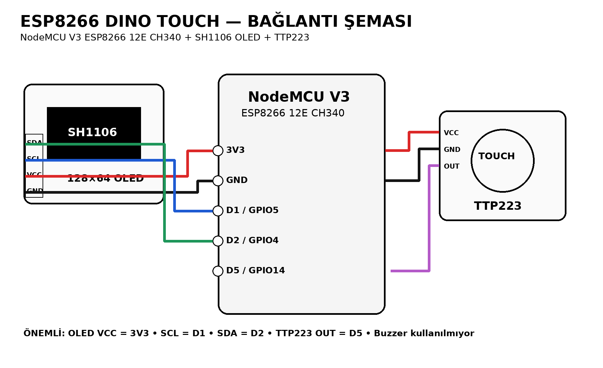
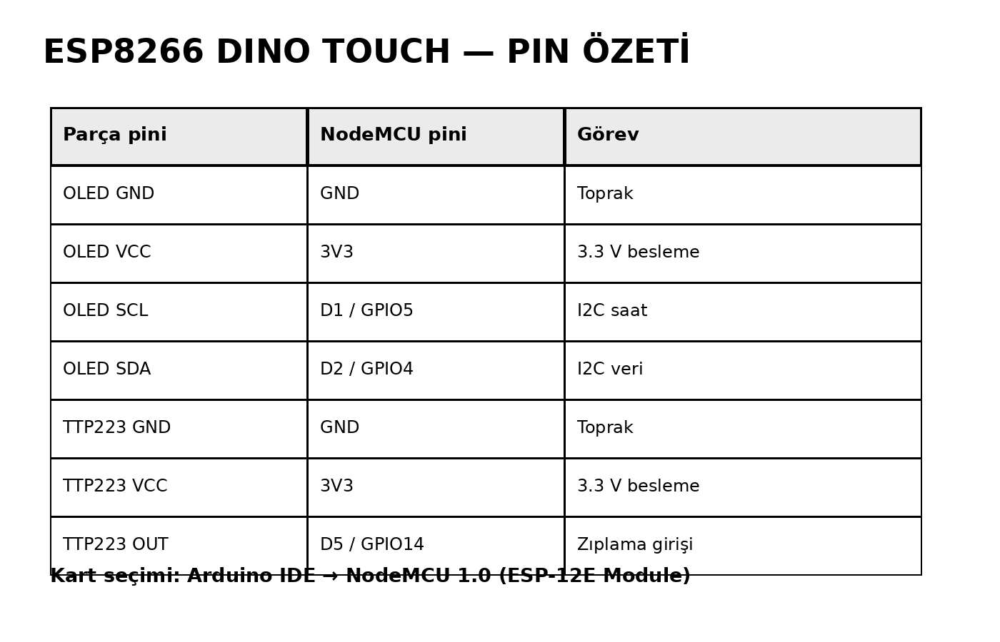

# ESP8266 Dino Touch

NodeMCU V3 ESP8266 12E CH340, 128x64 SH1106 OLED ve TTP223 dokunmatik sensör ile yapılmış mini Chrome Dino tarzı oyun.

## Özellikler

- NodeMCU V3 ESP8266 12E CH340
- 128x64 SH1106 I2C OLED
- TTP223 kapasitif dokunmatik sensör
- Tek dokunuşla zıplama
- Kaktüs engelleri
- Skor ve rekor
- Oyun ilerledikçe hızlanma
- Buzzer gerektirmez
- Tamamen çevrimdışı çalışır

## Gerekli parçalar

| Parça | Adet |
|---|---:|
| NodeMCU V3 ESP8266 12E CH340 | 1 |
| 128x64 SH1106 I2C OLED | 1 |
| TTP223 dokunmatik sensör | 1 |
| Breadboard | 1 |
| Jumper kablo | Yeteri kadar |
| USB veri kablosu | 1 |

## Bağlantılar

### OLED

| OLED | NodeMCU |
|---|---|
| GND | GND |
| VCC | 3V3 |
| SCL | D1 / GPIO5 |
| SDA | D2 / GPIO4 |

### TTP223

| TTP223 | NodeMCU |
|---|---|
| GND | GND |
| VCC | 3V3 |
| OUT | D5 / GPIO14 |

## Arduino IDE kurulumu

1. Arduino IDE'yi aç.
2. ESP8266 kart paketini kur.
3. Kart olarak **NodeMCU 1.0 (ESP-12E Module)** seç.
4. Kütüphane Yöneticisi'nden aşağıdakileri kur:
   - **Adafruit GFX Library**
   - **Adafruit SH110X**
5. `ESP8266_Dino_Touch.ino` dosyasını aç.
6. Doğru COM portunu seç.
7. Kodu karta yükle.

## Oyun kontrolü

- İlk dokunuş: oyunu başlatır.
- Oyun sırasında dokunma: Dino zıplar.
- Kaktüse çarpınca: GAME OVER.
- Tekrar dokunma: yeni oyun başlar.

## OLED adresi

Kod varsayılan olarak `0x3C` I2C adresini kullanır.

Ekran açılmazsa önce I2C adresini kontrol et. Bazı OLED modülleri farklı adres kullanabilir.

## Test edilen donanım

Bu proje şu yapı için hazırlanmıştır:

- NodeMCU V3 ESP8266 12E CH340
- SH1106 128x64 I2C OLED
- TTP223 dokunmatik sensör
- Buzzer yok

## Görseller

- `docs/wiring_diagram.png` — bağlantı şeması
- `docs/pin_map.png` — kısa pin özeti
- `docs/game_preview.png` — OLED oyun görünümü örneği
- `docs/wiring_diagram.svg` — ölçeklenebilir bağlantı şeması

## Sorun giderme

Ayrıntılar için `docs/troubleshooting.md` dosyasına bak.

## Lisans

MIT License.
